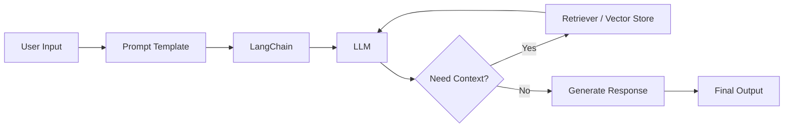

# LangChain Experiments

A collection of small projects and experiments built with LangChain to explore how large language models can interact with documents, APIs, prompts, and external tools. The repository is organized as a hands-on workspace for learning and prototyping LLM-powered applications.

## Highlights

- Prompt engineering examples
- LangChain chains and agents
- Document loading and processing
- Retrieval-Augmented Generation (RAG)
- Modular project structure
- Easy to extend with new experiments

## Repository Structure

```text
.
├── notebooks/
├── data/
├── src/
├── requirements.txt
└── README.md
```

## Workflow



## Getting Started

```bash
git clone <repository-url>
cd Langchain-main
pip install -r requirements.txt
```

Run the notebooks or Python scripts to explore each example.

## Tech Stack

- Python
- LangChain
- OpenAI / Compatible LLMs
- FAISS / Chroma (where applicable)

## Future Work

- Multi-agent workflows
- Memory-enabled assistants
- Tool integrations
- Evaluation pipelines

## License

This repository is intended for educational and experimentation purposes.
